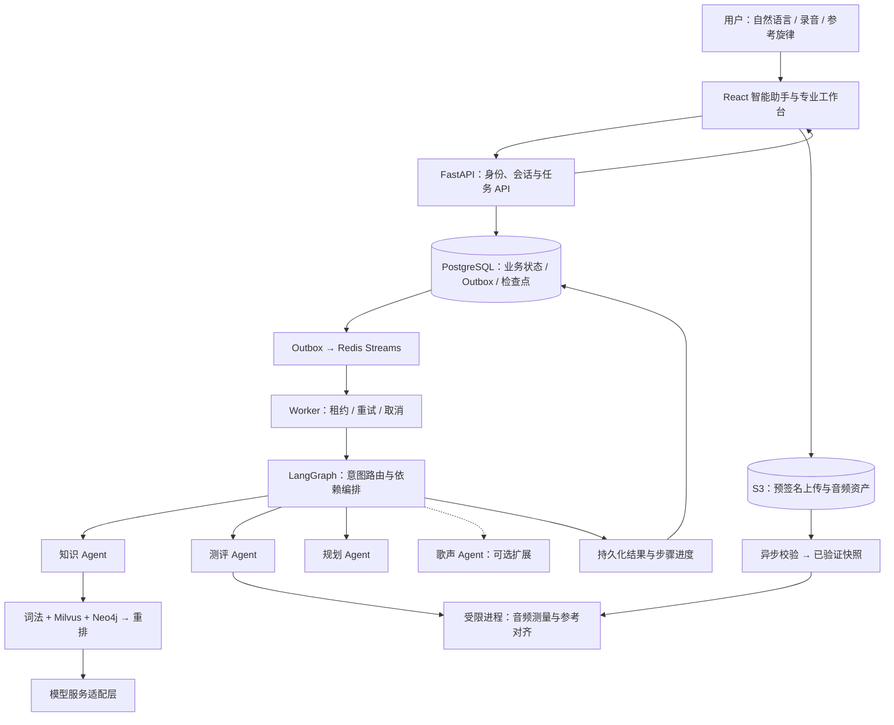

# DeepVocal

**基于 LangGraph 多 Agent 编排与 GraphRAG 的声乐学习助手。**

围绕「声乐知识解答 → 录音与曲目测评 → 个性化练习规划 → 练习反馈」构建业务闭环，将自然语言交互、音频计算、知识检索与异步任务执行整合到同一个产品中。

用户可以直接提出复合需求，例如：

> 解释一下音准和气息的关系，分析我上传的录音，再根据结果安排三天练习，每天十五分钟。

后端完成意图分类、子任务拆分和依赖排序，按需调用知识、测评与规划 Agent，结果直接回到助手对话中。专业工作台提供音频、参考旋律和练习参数的精细配置。

## 核心能力

| 能力 | 产品行为 | 实现重点 |
| --- | --- | --- |
| 声乐知识问答 | 声乐概念、发声技巧和练习方法的多轮问答；按需展示来源 | 词法、向量、实体图谱混合检索，候选保护与重排，证据有效性校验 |
| 录音与曲目测评 | 上传录音后生成音高、节奏、稳定性及片段报告；支持参考旋律与 MIDI | 预签名直传、异步音频校验、受限进程测量、参考对齐与可视化 |
| 个性化练习规划 | 基于测评报告和时间预算制定计划，支持多目标、编辑与反馈调整 | 测评依赖传递、每日时间预算、计划版本管理与反馈关联 |
| 智能助手交互 | 一条消息处理多个需求，展示步骤进度，支持取消、重试和历史恢复 | LangGraph 顺序编排、检查点恢复、会话与任务持久化 |

## 关键技术设计

### 结构化路由与多 Agent 协作

采用确定性意图规则与结构化路由，将请求归并为四类功能 Agent，并通过 LangGraph 管理状态转移。录音诊断与全曲测评共用测评 Agent；知识、测评、规划构成主业务链，歌声 Agent 承载可选扩展。

- **职责与工具权限绑定**：每类 Agent 配置工具白名单，执行前校验路由、参数、资源权限和前置条件，使工具调用可审计。
- **按依赖顺序执行**：先测评，再将报告传入规划；各步骤使用独立输入，防止录音时长等参数污染练习预算。
- **局部结果可交付**：缺少某一步的材料时单独提示，保留其他独立步骤的执行与回复；依赖缺失时保留明确的待补充状态。
- **检查点与恢复**：工具执行后保存状态，重试从失败节点继续；将用户可见进度与已保存的工作流状态关联。

入口：[意图路由](apps/api/app/agents/router.py) · [LangGraph 工作流](apps/api/app/agents/graph.py) · [多需求回归测试](apps/api/tests/test_multi_intent.py)

### GraphRAG 与可验证知识检索

结合词法检索、Milvus 向量召回和 Neo4j 实体关系检索，通过候选保护与 Cross-Encoder 重排组织证据。知识包记录来源、审核状态与语料指纹，索引与语料版本关联；回答环节校验证据与引用，界面按用户需要展示来源。

检索策略通过组件对照实验选择。实验显示，简单 RRF 融合可能牺牲排序质量，因此采用保护向量候选、补充图谱证据、再统一重排的方式，平衡召回覆盖与首位相关性。

入口：[知识服务](apps/api/app/knowledge/) · [离线对照实验](apps/api/app/knowledge/local_benchmark.py) · [评测与冻结集校验](apps/api/app/knowledge/benchmark_support.py)

### 面向长任务的可靠执行

使用 PostgreSQL 保存任务与业务状态，Redis Streams 承载任务通知，事务 Outbox 协调任务创建与消息投递。按至少一次投递设计消费流程，通过任务状态、Worker 租约、执行令牌和版本校验约束结果写入。

支持超时、重试、取消与租约过期恢复；最终结果入库时再次校验执行权，阻止旧 Worker 或已取消任务发布结果。音频计算在受限子进程中执行，避免长时间计算阻塞 API 服务。

入口：[Worker 与 Outbox](apps/api/app/worker.py) · [任务回归测试](apps/api/tests/test_jobs.py) · [音频进程测试](apps/api/tests/test_audio_process.py)

### 音频资产与用户隔离

录音通过 S3 兼容存储预签名直传，上传完成后由异步任务核验哈希、解码与音频属性，再发布独立的已验证快照供测评使用。上传对象与测评输入分离，避免后续覆盖上传文件改变已确认的分析输入。

身份层支持本地开发身份和 OIDC JWT 校验；会话、任务、音频、报告与计划均按 owner 隔离。测评结果关联原始资产和参数，练习计划关联报告与反馈，形成可追溯的数据链路。

入口：[身份校验](apps/api/app/auth.py) · [上传工作流](apps/api/app/upload_workflows.py) · [身份与资产测试](apps/api/tests/test_auth_uploads.py)

## 实验设计与验证结果

### 检索组件对照

2026-11-06 的本地实验使用 **110 个知识片段、250 条可回答的中英文查询**，其中开发集 178 条、冻结集 72 条。固定语料指纹、模型版本和查询标签，对比检索与重排组件；使用 BGE-M3、BGE-Reranker-v2-M3 INT8，重排候选上限为 12。下表报告同一组 **72 条冻结查询**的结果：

| 检索策略 | Recall@5 | MRR@5 | NDCG@5 |
| --- | ---: | ---: | ---: |
| 词法检索 | 38.89% | 0.2708 | 0.3028 |
| 向量检索 | 84.03% | 0.6942 | 0.7275 |
| 向量检索 + 重排 | 88.89% | 0.7928 | 0.8152 |
| 词法 + 向量 + 图谱，RRF 融合 | 87.50% | 0.6701 | 0.7214 |
| **候选保护 + 混合检索 + 重排** | **94.44%** | **0.8356** | **0.8615** |

最终组合相较向量基线，Recall@5 提升 **10.42 个百分点**、MRR@5 提升 **0.1414**；相较「向量 + 重排」，Recall@5 提升 **5.56 个百分点**。全量 250 条查询上，最终组合的 Recall@5 为 **96.40%**，向量基线为 88.80%。

评测采用工程标注与来源分组，冻结来源覆盖七篇英文乐理文档；查询含同一事实的改写，标签未经专家独立裁定。结果用于本项目检索策略选择，衡量证据召回与排序；生成回答质量、教学效果另行评估。

### 音频测量与工程回归

- **音高测量**：在 vocadito 的 40 段单声部音频上，对齐人工 F0 标注，以 50 cents 为容差，得到片段宏平均 Raw Pitch Accuracy **92.84%**。实现为 `mono-autocorrelation-v1`，该指标衡量基频跟踪质量。复跑入口：[benchmark_audio.py](scripts/benchmark_audio.py)。
- **路由实验工具**：支持配对比较单 Agent 基线与 LangGraph 多 Agent 调用轨迹，统计请求级／调用级工具误调用率、非法执行数和任务完成率；被拦截的错误尝试仍计入误调用。入口：[evaluate_routing.py](scripts/evaluate_routing.py)。
- **工程回归**：2026-11-07 的本地后端回归为 **148 passed、1 skipped**；桌面与手机端验证多需求对话、真实上传测评、计划关联、取消恢复与按需来源展示。GitHub Actions 持续执行后端测试、静态检查、前端类型检查与构建。

评测程序随代码维护，语料、标签和逐条结果在独立数据目录管理。固定输入、模型与语料指纹后，可重复运行组件对照与失败样例分析。

## 系统架构



| 层次 | 技术与用途 |
| --- | --- |
| 前端 | React、TypeScript、Vite；对话界面、任务进度、音频报告、计划管理 |
| API 与数据模型 | FastAPI、Pydantic、SQLAlchemy、Alembic；接口契约、参数验证与迁移 |
| Agent 编排 | LangGraph、PostgreSQL Checkpointer；结构化路由、子图与状态恢复 |
| 知识检索 | Milvus、Neo4j、BGE-M3、Cross-Encoder；向量与实体检索、候选融合与重排 |
| 任务与存储 | PostgreSQL、Redis Streams、S3 兼容存储；事务状态、任务投递与音频资产 |
| 音频计算 | NumPy、SciPy、SoundFile、MIDI 解析；基频跟踪、参考对齐与测量报告 |
| 身份与交付 | OIDC/JWKS、Docker Compose、pytest、Playwright、GitHub Actions |

### 扩展设计

歌声生成作为独立扩展，通过适配层接入可替换引擎，并管理声音授权、取消和资产清理。项目优先围绕测评与练习闭环组织业务，生成侧按模型算力、外部服务费用和声音授权要求独立配置与启用。

相关实现：[业务适配层](apps/api/app/singing.py) · [独立推理服务](apps/singing/) · [引擎准备脚本](scripts/setup_singing.ps1)

## 快速运行

推荐使用 Docker Desktop 的 Linux 容器。将 `.env.example` 复制为 `.env`，已有配置保留，然后在项目根目录运行：

```powershell
docker compose --env-file .env -f infra/docker-compose.yml -f infra/compose.app.yml up -d --build --wait
```

网页入口：`http://127.0.0.1:8080`；交互式 API：`http://127.0.0.1:8000/docs`。

知识问答通过 `.env` 配置模型服务，并从本地 `datasets/` 只读挂载知识资料；也可使用 `DEEPVOCAL_CORPUS_DIR` 指定目录。运行时按来源登记与审核状态准备知识包，再通过 `python -m app.knowledge.cli ingest` 构建检索索引。模型密钥通过环境配置管理。

本地调试使用 Python 3.12、Node.js 24 和 Docker 基础服务：

```powershell
.\scripts\dev.ps1 setup
# 分别在三个终端启动
.\scripts\dev.ps1 api
.\scripts\dev.ps1 worker
.\scripts\dev.ps1 web
```

本地前端入口为 `http://127.0.0.1:5173`。与整套 Compose 切换时，先停止原有 api、worker、web 应用进程，再启动本地进程。

## 代码导航与验证

| 目录 | 职责 |
| --- | --- |
| `apps/web/` | 助手与工作台、报告与计划界面、浏览器回归测试 |
| `apps/api/app/agents/` | 意图规则、Agent 工具权限、LangGraph 工作流 |
| `apps/api/app/knowledge/` | 知识包治理、实体检索、模型适配、检索评测 |
| `apps/api/app/` | 会话、身份、音频、计划、Worker 与业务 API |
| `apps/api/migrations/`、`apps/api/tests/` | 数据库迁移、单元与集成测试 |
| `apps/singing/` | 可选歌声引擎与独立推理服务 |
| `infra/` | 应用、数据库、对象存储、身份及监控服务编排 |
| `scripts/` | 开发启动、数据准备、实验评测、备份恢复与仓库检查 |
| `contracts/runtime-openapi.json`、`.github/workflows/` | API 工程契约与持续集成 |

```powershell
.\scripts\dev.ps1 test
.\scripts\dev.ps1 e2e
.venv\Scripts\python.exe scripts/check_repository.py
```

浏览器测试需启动 API、Worker、网页与对象存储；Compose 网页入口可通过 `E2E_BASE_URL=http://127.0.0.1:8080` 指定。CI 使用临时数据库和合成测试样例，支持独立验证代码。检索实验使用本地评测输入，通过 `python -m app.knowledge.local_benchmark --help` 查看配置与运行参数。
