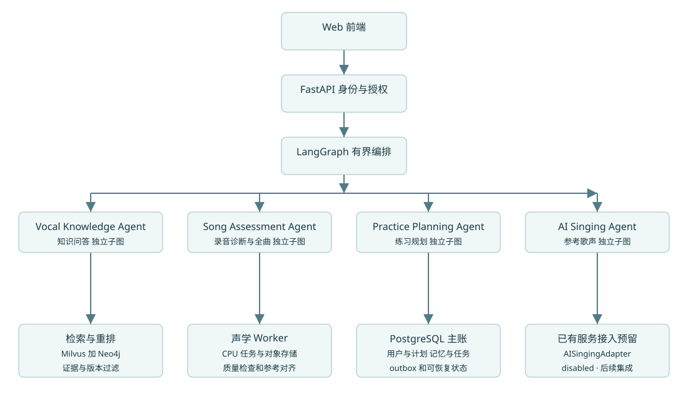

# DeepVocal 概要设计

采用模块化单体、独立 worker 与四个 LangGraph 专业子图。FastAPI 是身份与资源边界；Supervisor 只编排，不是第五类专业 Agent。各子图可以共用同一付费 LLM，但工具、提示词、局部状态独立。未选中的专家不执行。

## 组件责任

|组件|责任|不承担的责任|
|---|---|---|
|Web React+TypeScript|输入、确认动作、上传进度、报告与恢复入口|不能以客户端 owner/隐藏按钮代替权限|
|FastAPI|OIDC 验证、输入校验、幂等、事务、workflow/job API|不在请求事件循环运行长音频 CPU 分析|
|SupervisorGraph|规则+分类、依赖 DAG、预算、等待和输出验证|不直接增加工具权限或猜测缺失资源|
|Knowledge|中文证据问答；knowledge.retrieve|不创建测评/计划/生成任务|
|Assessment|短测和全曲；audio.inspect、assessment.submit/get_report|不输出疾病或未启用的成因标签|
|Planning|reports.read、knowledge.retrieve、plans.create/update|不越过用户已确认的目标与分钟|
|Singing|singing.capabilities；disabled 提示|当前无 singing.submit，不调用已有外部设备|
|PostgreSQL|业务事实、workflow/事件/审核/删除主账|不替代音频对象与向量/图谱索引|
|Milvus/Neo4j|同版本向量与关系投影|不自行产生证据或作为授权唯一来源|
|对象存储|私有不可变版本的媒体原件与派生物|不以永久公开 URL 暴露用户文件|
|队列/worker|至少一次交付、有限重试、租约、独立进程解码|队列不是唯一事实来源；Redis 不是必选业务主账|

队列可以理解为后台待办清单，对象存储是录音文件仓库。候选是 Redis 队列与 S3 兼容私有存储；具体产品在 M1 初始化给用户选项。应用以适配接口隔离，不把当前没有选择的产品写成已部署事实。

## 业务链路

问答：身份→中文活动语料/权限过滤→结构化路由→向量召回→映射实体种子→受限图扩展→去重融合重排→Evidence 验证→回答。图谱不可用时可在同版本向量证据范围降级，向量和证据均无效则说明不足。

测评：用户授权分析→申请上传→上传原件→complete 核验对象版本/大小/哈希→资产 ready→用户明确提交→job/outbox 原子写→worker 安全解码/质量检查/测量/评分→报告事务提交。上传完成本身不创建测评。异步质量检查成功但输入不可测时，job SUCCEEDED、report quality_failed、分数不可用；基础设施或解码失败为 FAILED。

评估后规划：用户一次明确确认包含两步的动作，workflow 先等测评 job；成功且报告可访问后读取证据和当前偏好生成计划。缺时间/目标则 WAIT_USER_INPUT；质量失败只能提出重录或经用户确认的一般计划，不把失败结果变成针对性诊断。

## 事务和投影

事务中写业务主账和 outbox；投递至少一次，消费者以事件 ID 去重，结果与消费回执同事务。图谱/向量分批构建，不假设分布式事务；同一个不可变 corpus_version 全部检查后才原子激活。状态和资源可见性以 PostgreSQL 为准，缓存和投影在读取前后都服从删除/授权 revision。

## 主要工程约束

OIDC 身份键为 issuer+subject。owner 只能从服务端注入。checkpoint 存资源 ID 和版本，不存临时签名 URL、密钥、原音频或无限历史。CPU 音频用隔离 worker 进程；API 超时不会自动取消已提交 job。真实服务异常不得静默换 Mock。

当前目标是本机研究，不承诺生产并发；Milvus 的实际版本部署依赖在环境锁中按官方版本补齐。生成关闭只影响该功能，不应使 readiness 因缺 GPU/生成服务而失败。任何供应商网关均为可选组件，GraphRAG 不是特定 OpenAI 兼容接口的同义词。
