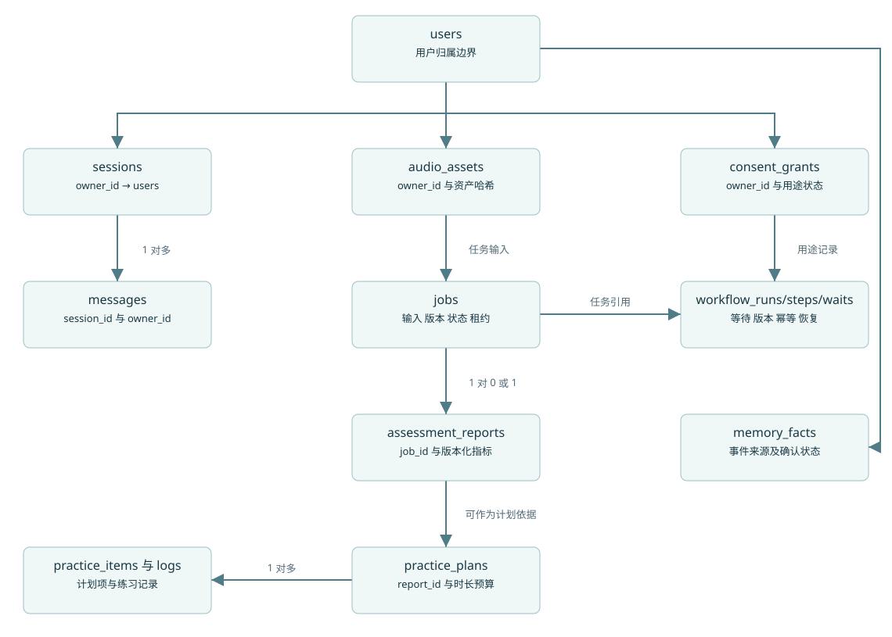

# DeepVocal 数据库设计

PostgreSQL 保存事务主账；候选完整 DDL 见 database/schema.sql。它是开发建迁移的输入，本轮没有对运行中的数据库执行建表。Milvus/Neo4j 只保存可重建投影；SQLite seed 是离线准备库，不是业务主库。确切表数见 contracts/database-model.json 自动清单。

## 表组与设计责任

|表组|主要数据|一致性约束|
|---|---|---|
|用户/会话|users、profiles、sessions、messages|issuer+subject 唯一；资源 owner 来自认证；消息复合外键|
|媒体/任务|audio_assets、jobs、job_attempts、asset_derivations|不可变对象版本与哈希；claim_token fencing；每job最多一个成功报告|
|工作流|workflow_runs、workflow_steps、workflow_waits|owner/session 绑定、父运行同owner、步骤键唯一、等待令牌哈希与版本|
|测评/计划|assessment_reports、report_segments、practice_plans/items/logs|分数规则版本；片段时间合法；打卡 item/owner 唯一；版本化修改|
|知识/图谱|knowledge_sources、corpus_versions、documents/chunks、graph_entities/relations、chunk_entity_links|来源许可和语言；同版本同域映射；有效证据才投影|
|审核/映射|corpus_reviews、seed_id_mappings|review_level 不冒充专家；原始字符串 ID 显式映射 UUID|
|Skill|skills、versions、reviews|发布版本不可原地改；私有模板域受控|
|Memory|events、facts、profiles、fact_sources、profile_sources、compaction_runs|来源链复合owner外键、source_version去重、revision/watermark CAS|
|授权/保留|consent_grants、voice_consents、retention_preferences|独立用途、撤销可追溯、期限合法；声音用途当前预留|
|交付/删除|idempotency_keys、outbox_events、event_consumptions、deletion_ledger、deletion_requests、audit_events|同事务消费回执；tombstone不可因备份恢复遗失|

## 归属与图谱隔离

knowledge_chunks 不再重复 scope/owner，必须 join knowledge_documents 和 corpus_versions 获取权限；避免复制字段互相矛盾。graph_entities/relations 绑定 corpus，chunk_entity_links 必须映射同 corpus。公开/私有 corpus 由 owner_id 与 scope CHECK 决定。跨表“同语料同域”、source可用性与relation evidence span仍需事务服务校验；不能声称单条外键覆盖所有语义。

所有私有业务引用使用 (id,owner_id) 复合外键。某表不带 owner（如 report_segments）只能经其已验证父表访问。默认无 RLS 时服务仓储每次限定 owner；如果未来加 RLS，连接池必须按事务设置并清除上下文，不能因启用 RLS 删除服务鉴权。

## JSONB 与版本

metrics、scores 对应 OpenAPI Metric/ScoreBundle；空值语义由 JSON Schema 和服务验证。plan instructions/evidence、memory fact payload、retrieval config/evidence、Skill manifest 均带 schema_version，顶层对象/数组按 DDL 所列 CHECK 和服务 schema 校验共同约束；不得将任意模型 JSON 直接入库。LLM 结构修复失败不落半成品。

评分保留 measurement_version、ruleset_version、alignment/reference/config hash；只换中文解释时更新 explanation_version，不覆盖原测量。L3 使用关系表保存来源事实，同时保留 JSON 快照便于审阅。来源 UUID 与 seed 的字符串 ID 通过固定 namespace UUIDv5+source/version/locator 映射，绝不采用 Python hash() 或随机重建映射。

## 不能只靠 DDL 的事务约束

计划中 day_index<=plan.days、每天任务时长总和<=minutes_per_day；路径 plan_id 必须与 item.plan_id 相等。完成日志不随计划重写，已完成 item 不可修改，调整生成新 revision 并继承 family_id。检查和写入锁同一 plan，避免两次并发修改各自通过总量检查。

任务认领及提交校验 token、lease、version；报告归属的 job.kind 必须为 assessment。任何参考资产必须 ready、本人可见、用途匹配，不能用 upload purpose 字符串代替实际格式检测。来源许可撤回、corpus原子激活、生成关闭、授权有效性、保留策略和删除传播在服务事务执行。

## 删除与迁移

软删除先阻断读取并写 deletion_ledger；后台按来源链删除派生物。用户账户先 pending_delete，完成依赖清理/审计最小化后再物理移除；默认 RESTRICT 外键不是全表级联删除策略。不可将重置开发库当正常删除实现。

未来用 Alembic 建初始迁移并做空库升级、已有数据升级、回滚/前滚修复、外键和并发测试。checkpointer 自带表由其包版本迁移，在环境锁记载；业务 DDL 不虚构兼容其内部 schema。新增 NOT NULL 列需先回填再加约束；索引变化评估大表锁，不能在生产盲目重跑 schema.sql。

## 费用和评分存储补齐

provider_budgets/provider_reservations 是付费并发准入主账，分别保留日上限、已结算/预留金额及一次外呼的 effect_key、请求ID、unknown状态和version。锁预算行后才预留；未知收单不释放预留。它们不存银行卡或供应商密钥。Report 的 scores/quality/reference_snapshot 为对象、metrics/limitations 为数组；服务必须校验完整契约后写入，不能靠空对象默认绕过必填评分字段。reference_snapshot 保存参考哈希、移调、对齐参数和配置版本，保证之后复算不随原参考改变。

计划 family_id+revision 唯一；修改生成新修订时，已完成 item 保留在历史修订、日志不复制，未完成 item 新建 ID 并带来源映射。活动计划视图联合本 family 历史已完成记录，不能以复用 item ID 同时归属两个 plan。所有修订操作锁 family，防重复 revision 或双活动版本。
