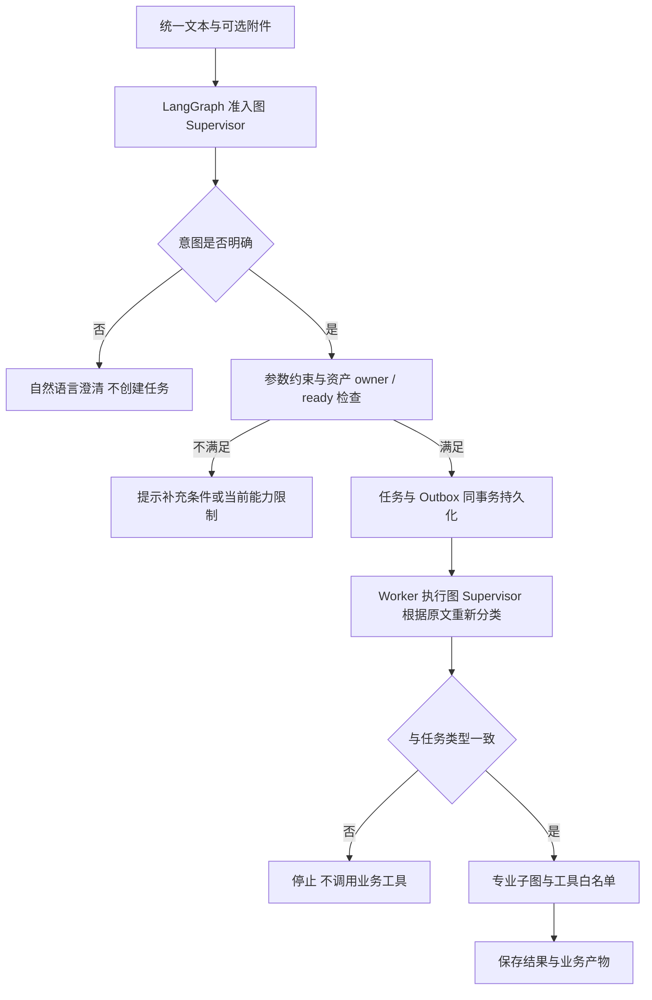

# 智能助手与专业工作台双模式

实施日期：2026-11-04。默认进入智能助手；用户直接输入问题或目标，后端识别意图并选择处理子图。左上角可切换专业工作台，保留四类功能、结构化参数、运行诊断、Skill 与 Memory 管理。用户不必理解 Agent 名称或自行选择路由。

## 用户交互

首次访问默认智能助手。浏览器 localStorage 的 `dv.mode` 只保存显示模式；刷新后保留上次选择，不影响用户身份或后端权限。模式切换不提交任务、不改变任务归属、不取消已有后台任务。执行中的任务可继续轮询，历史记录可重新查看。身份切换仍清除前一身份的任务、计划、报告与附件显示。

智能助手提供统一文本框、可选清唱附件和发送按钮。示例按钮只填写输入框，不提交请求，不携带任何 Agent 类型。请求不发送 `action`、`kind` 或模型生成的路由结果。页面不显示 Supervisor、工具调用链、Skill 内部信息或路由原因；任务记录使用业务名称。计划仍能在本模式内查看、编辑和记录练习反馈。

专业工作台保留明确功能选择和参数表单。显式提交携带 `knowledge.ask`、`planning.create`、`assessment.submit` 或 `singing.generate`。既有“自动识别意图”按钮继续使用自动入口。

## 后端执行链



准入图与执行图共享 `agents.graph.supervisor` 和 `RuleRouter`。准入图只负责分类，不执行检索、创建计划、音频分析等业务工具，不使用业务执行图的 checkpoint。这样既能在排队前返回澄清，也不会把未明确的请求投入错误任务队列。

自动任务在服务端保存 `request.routing={mode: automatic, version: rules-v2}`；该字段不属于客户端 JobCreate schema，也不从用户 input 复制。来源信息参与请求哈希，自动与显式请求不能通过相同幂等键混用。Worker 对自动任务不传显式 action，而是再次按原文运行 Supervisor。`expected_agent` 来自数据库任务类型；前后分类不同就抛出边界错误，业务工具尚未执行。路由规则升级时须检查旧排队任务，不能绕过这层保护重试。

显式功能任务和此前没有 routing 标记的历史任务保留原执行方式。owner/job/thread_id 继续由服务端生成；本次不改变 checkpoint 恢复、取消、租约、预算、工具白名单或产物幂等语义。

## 分类与参数边界

当前实现是**确定性规则意图分类**，不是已经接通的 LLM 分类器。无需模型 Key 即可运行 LangGraph 编排。规则同时考虑动作词、业务对象与理论提问，避免“如何”一律进入问答、“音准”一律进入测评。示例：

| 用户输入 | 结果 |
| --- | --- |
| 什么是音准 / 什么是歌声生成 | 声乐知识问答 |
| 如何制定音准练习计划 | 练习规划 |
| 如何分析这段录音 | 录音分析，缺材料时先提示 |
| 请分析录音，并制定练习计划 | 澄清本次主要目标，无任务 |
| 请给我生成一段歌声 | 返回生成能力未配置，不生成音频 |
| 你好 / 含义不明确的输入 | 请补充具体业务目标 |

自动规划从本次描述中提取基础、音准、节奏或长音稳定目标；支持阿拉伯数字和常见中文数字，时长每天 5–30 分钟，天数 1–7 天。未描述的字段采用基础、10 分钟、3 天，页面提前告知；实际计划卡片显示采用的值。这些默认值显式入库，本入口不暗中用跨会话偏好覆盖。

多个时长、多个练习目标、超范围数字、区间/小数、小时/周/间隔日排期、需要历史报告但未选择报告、未支持的专项模板会要求补充。出现疼痛或明显不适时仍走停止练声规则。此解析器覆盖受支持表达，不保证理解任意自然语言、否定句或隐含目标；扩展时须添加误路由与误提取错例，不能只增加宽泛关键词。

澄清没有创建业务任务或 Outbox 事件。当前没有会话澄清状态机；用户应在输入框保留的原请求中补充后重新发送，单独回复“3天”等片段不会自动继承之前上下文。未来若加入多轮理解，需要单独设计 owner 隔离、上下文版本、有效期与幂等，不能把前端显示模式当成后端会话状态。

## 音频与外部服务

附件只有录音分析会使用。非音频任务不会因附件仍 pending 被拦截，也不会读取附件。录音分析继续校验 owner 和 ready；他人/不存在资产返回相同的 404，不暴露资产状态。缺录音时提示附上清唱；pending 时返回 `blocked` 和中文原因，不创建测评任务。

保留用户确认的**仅预签名上传**范围：浏览器 PUT 不代表资产通过校验。所有新上传仍 pending，不启用完成回调或手动改 ready。自动入口暂不把“全曲”或“长音”降级成默认自由清唱测量；需要参考音符/目标时长时提示进入专业工作台，但目前专业工作台的用户上传测评也仍受校验未开放限制，参数表单尚未全部开放。

未配置模型 Key 时问答仅返回资料预览；歌声生成只返回未配置状态。界面模式不会启用任何付费调用或解除中文资料审核门控。

## 运行合同与验证

`POST /v1/assistant` 的自动请求：

```json
{
  "text": "帮我制定音准练习计划，每天15分钟，共5天",
  "idempotency_key": "client-generated-unique-key"
}
```

可附 `input_asset_id`；自动模式 `input` 必须为空。显式模式继续接受相应结构化 input。成功准入返回 `status=queued` 与 job；需要补充返回 `status=clarify`；当前 pending 限制返回 `status=blocked`。这些业务状态均为 HTTP 200，权限、格式错误和幂等冲突仍使用对应 HTTP 错误码。客户端必须先判断 status，不能收到 200 就显示“任务已创建”。空白文本、空 action、非法幂等键由模型校验拒绝。

实际 schema 见 `contracts/runtime-openapi.json`；数据库结构不需迁移。回归覆盖自动请求不传 action/kind、真实 Worker 运行自动规划并落库、重复请求不重复任务、分类变化不调用工具、输入冲突不排队、pending/他人资产不排队，以及桌面/手机的模式切换、问答、计划编辑、附件、能力限制和身份隔离。

执行命令与本轮最终验证结果见交付记录及 GitHub CI；设计能力缺口仍以31、39章为准，不将本次双模式交互当成全部目标验收。

本轮本机验证：后端75项通过（无跳过，含真实 PostgreSQL、Redis、Milvus/Neo4j 往返）；Ruff与前端构建通过；桌面/手机共4项浏览器端到端用例通过；可移植设计合同检查91项通过。浏览器用例使用合成音频与独立测试身份，不计为真实用户或教学效果评测。Docker应用服务健康检查通过，测试库与业务库隔离。依赖仍有 LangGraph 与 pymilvus 上游弃用提示，不影响本次结果。
